Performance Report
==================

BasicAnalysis generates an interactive performance report that organizes the
analysis into complementary views. Each view addresses a different question
about the application's performance and helps progressively narrow down the
factors responsible for efficiency loss.

The report is intended to support a hierarchical analysis workflow. Start with
the Execution Overview to verify the analyzed configurations, then use the
Parallel Runtime Model to identify the main sources of efficiency loss.
Runtime-Specific Analysis provides a more detailed view of the active parallel
runtimes, while the Host/Device Model (TALP) identifies where accelerator-related
inefficiencies manifest. For *nsys2prv* traces with GPU metrics, GPU Hardware
Counters shows how the GPU resources are exercised while the device is
active. I/O Analysis provides a complementary view of the weight of File I/O
and of its Data Access and File Management components. Finally, the Scaling view shows
how performance and efficiency factors evolve across the analyzed
configurations.

Throughout this workflow, Metric Details provides contextual guidance to
help interpret the reported metrics and continue the performance diagnosis.

These views are complementary and may use different analytical scopes. Not all
metrics shown in the report belong to the same multiplicative efficiency model.

The following sections describe the report interface, the purpose of each
analysis view, and the functionality available to support the performance
analysis.

Report Interface
----------------

The BasicAnalysis performance report is organized around the following primary
analysis views, shown when they apply to the analyzed traces:

* **Execution Overview**
* **Parallel Runtime Model**
* **Host/Device Model (TALP)**
* **GPU Hardware Counters** (*nsys2prv* traces with GPU metrics)
* **I/O Analysis**
* **Scaling**

Use the navigation bar shown in
:numref:`fig-report-report-main-navigation` to move between the different
report views.

.. _fig-report-report-main-navigation:

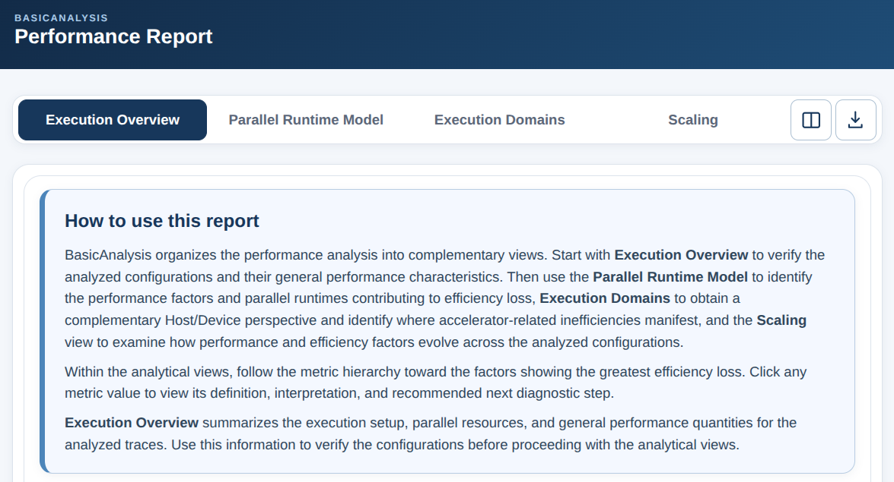

   Performance report navigation.

Runtime-specific analysis is accessed from the Parallel Runtime Model through
the **Runtime Analysis** selector rather than as a separate primary view.

Metric values in the interactive efficiency tables can be clicked to open the
**Metric Details** view. This view provides the metric definition,
interpretation of the observed value, and recommended next diagnostic steps.
The Metric Details functionality is described later in this chapter.

The controls on the right side of the navigation bar provide access to the
complementary split view and to the report export functions. These features
are also described later in this chapter.

Execution Overview
------------------

The **Execution Overview**, shown in
:numref:`fig-report-execution-overview`, is the starting point of the analysis.
It summarizes the execution configuration and general performance
characteristics of the analyzed traces.

.. _fig-report-execution-overview:

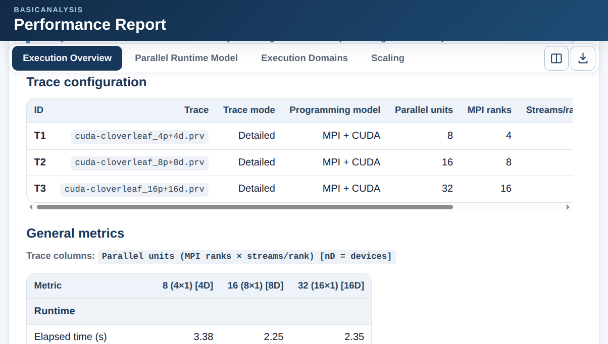

   Execution Overview.

Before interpreting efficiency metrics, verify that the reported trace
configuration corresponds to the intended experiment. In particular, check the
programming model, parallel resources, and accelerator configuration when
applicable.

The General Metrics table provides the main execution quantities used to
compare the analyzed configurations, including elapsed time, Speedup,
Efficiency, IPC, and processor frequency when available.

When several execution configurations are analyzed, these values provide an
initial indication of whether application performance improves as resources
increase. The detailed efficiency and scaling views should then be used to
identify which factors explain the observed behavior.

Parallel Runtime Model
----------------------

The **Parallel Runtime Model**, shown in
:numref:`fig-report-parallel-runtime-model`, identifies the performance factors
and parallel runtimes contributing to efficiency loss.

.. _fig-report-parallel-runtime-model:

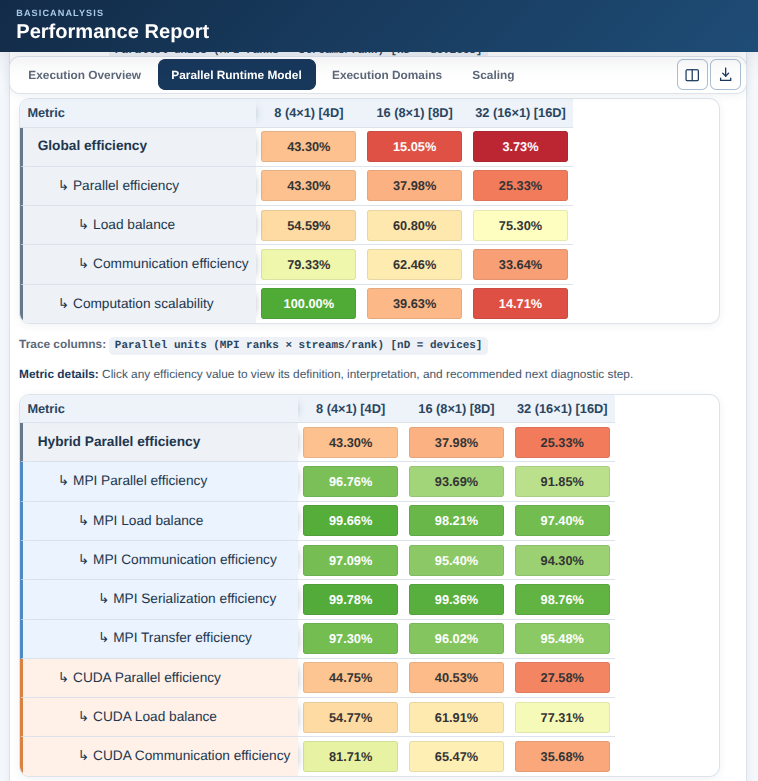

   Parallel Runtime Model view.

Start with **Global Efficiency** and follow its child metrics toward the
lowest-efficiency factors. Global Efficiency separates losses associated with
Parallel Efficiency from changes in Computation Scalability.

For hybrid applications, the Parallel Runtime Model additionally decomposes
Parallel Efficiency across the active parallel runtimes.

The model can therefore be read in two complementary ways:

* **by performance factor**, following Global Efficiency toward Parallel
  Efficiency, Load Balance, Communication Efficiency, and Computation
  Scalability; or
* **by runtime**, comparing the contributions of MPI and the inner parallel
  runtime.

The performance-factor hierarchy identifies what type of efficiency loss is
present, while the runtime decomposition helps determine which parallel
runtime contributes to the observed loss.

In the interactive report, metric values are selectable. Clicking a metric
value opens its definition, interpretation, and recommended next diagnostic
step.

Runtime-Specific Analysis
-------------------------

When a runtime requires closer investigation, select it from the
**Runtime Analysis** selector. A split view opens, displaying the metrics
specific to the selected runtime while keeping the Parallel Runtime Model
visible for context. An example for the OpenMP parallel runtime is shown in
:numref:`fig-report-runtime-analysis`.

.. _fig-report-runtime-analysis:

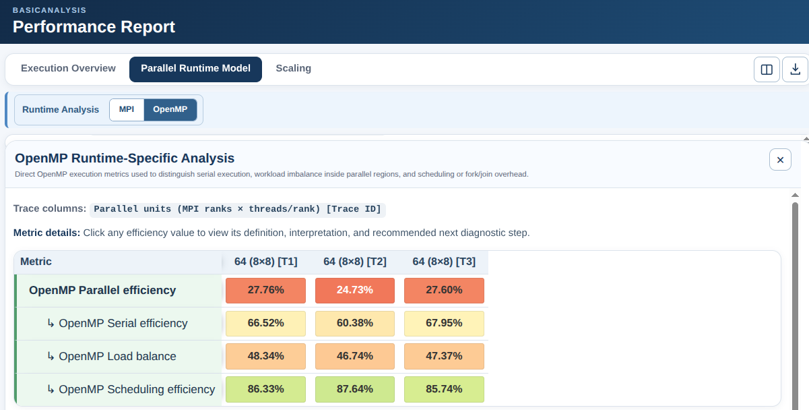

   Runtime-specific analysis.

The selected runtime opens in the detailed-analysis panel while the Parallel
Runtime Model remains visible for context.

The available runtime-specific metrics depend on the programming model. For
example:

* MPI analysis examines MPI Load Balance and Communication Efficiency,
  including Serialization and Transfer Efficiency when available.
* OpenMP analysis provides the isolated OpenMP Serial, Load Balance, and
  Scheduling efficiencies.
* CUDA or HIP analysis displays the corresponding accelerator-runtime
  contribution defined by the selected hybrid model.

Runtime-Specific Analysis is intended to explain the runtime contribution
identified in the Parallel Runtime Model. Its metrics may therefore use a
different analytical scope from the application-level metrics.

Host/Device Model (TALP)
------------------------

For accelerator applications, the **Host/Device Model (TALP)** view provides
a complementary analysis of where performance inefficiencies manifest by
separating the execution into **Device** and **Host** domains, following the
TALP model. The Device metrics are shown first.

.. _fig-report-execution-domains:

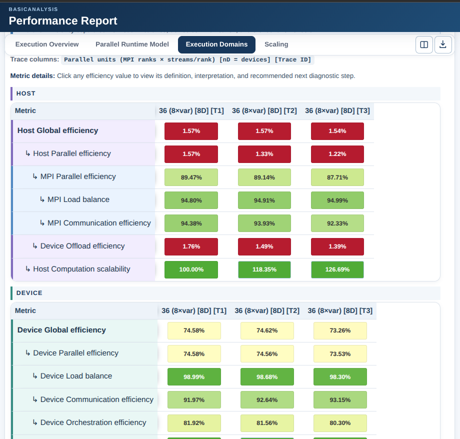

   Host and Device execution-domain analysis.

:numref:`fig-report-execution-domains` shows an example of the Host and Device
execution-domain analysis.

The Device domain characterizes accelerator execution through Device Parallel
Efficiency and its Load Balance, Communication, and Orchestration components,
together with Device Computation Scalability. With two or more traces, Device
Computation Scalability is split into Device Work and Throughput Scalability
(and, for *nsys2prv* traces with GPU metrics, Throughput into Issue and
Frequency Scalability), shown in the Device table and in the *Device
Computation Scalability* plot of the Scaling view (see
:ref:`device-work-throughput`), followed by the card **Which kernels change
the device time?** (see `Scaling`_).

The Host domain characterizes CPU-side execution, including Host Parallel
Efficiency, accelerator offload behavior, and Host Computation Scalability.

For Device metrics, GPU stream activity is first mapped and flattened to the
corresponding physical devices. Consequently, the Device analysis represents
physical accelerator activity rather than treating individual GPU streams as
independent parallel execution units.

Host and Device are complementary execution domains and are **not** components
of a common multiplicative efficiency model. Therefore, Host Global Efficiency
and Device Global Efficiency must be interpreted independently and must not be
multiplied to obtain the application Global Efficiency.

Use the Parallel Runtime Model to determine **which runtime contributes to the
efficiency loss**, and the Host/Device Model (TALP) view to determine **where
accelerator-related inefficiencies manifest**.

A low execution-domain metric identifies where a performance loss becomes
visible. Detailed runtime or trace analysis may still be required to determine
the underlying cause.

GPU Hardware Counters
---------------------

For *nsys2prv* traces whose Nsight Systems report includes GPU metrics, the
**GPU Hardware Counters** view characterizes how the GPU resources are
exercised while the device is active. It complements the Device metrics of
the Host/Device Model (TALP), which characterize how effectively the
accelerator is kept supplied with useful work over the execution.

.. _fig-report-gpu-hardware-counters:

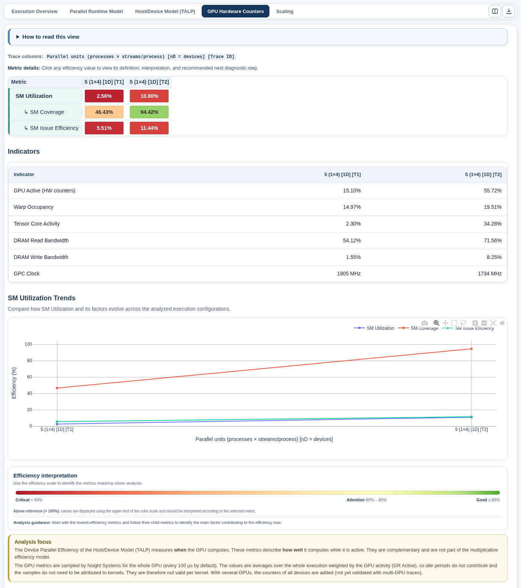

   GPU Hardware Counters.

The view, shown in :numref:`fig-report-gpu-hardware-counters`, includes:

* **SM Utilization**, the degree to which the SMs issue instructions while
  the GPU is active (not a fraction of the peak instruction throughput), and
  its factors **SM Coverage** (are the available SMs given
  work?) and **SM Issue Efficiency** (do the active SMs issue instructions?).
  They use the same efficiency colour scale as the other views.
* **Indicators** that explain the SM Utilization chain: GPU Active (a
  consistency check with the kernel events), Achieved Occupancy (run
  average, not per kernel), Tensor Core Activity, DRAM Read and Write
  Bandwidth, and GPC Clock. A higher indicator value is not necessarily
  better, so they are shown in a single neutral colour, and
  their Metric Details explain how to read each indicator and what low and
  high values mean, instead of giving an efficiency verdict.
* A **Diagnostic path** that summarizes the diagnostic workflow of
  :ref:`gpu-hardware-counter-metrics`: SM Coverage, then SM Issue
  Efficiency, explained with Achieved Occupancy and the DRAM bandwidth, and
  finally Tensor Core Activity and the GPC Clock as context. The path helps
  formulate hypotheses to investigate in the trace with Paraver, not assign a
  root cause.
* A trend plot of SM Utilization and its factors when several executions are
  analyzed.

As in the other views, click any value to open its Metric Details.

The metrics are averages over the whole execution weighted by the GPU
activity. They are not part of the multiplicative efficiency model and are
not valid per kernel. See :ref:`gpu-hardware-counter-metrics` for their
definitions.

I/O Analysis
------------

The **I/O Analysis** view provides a complementary characterization of the
File I/O (POSIX, ANSI C, and MPI-IO calls) captured in the analyzed traces.

.. _fig-report-io-analysis:

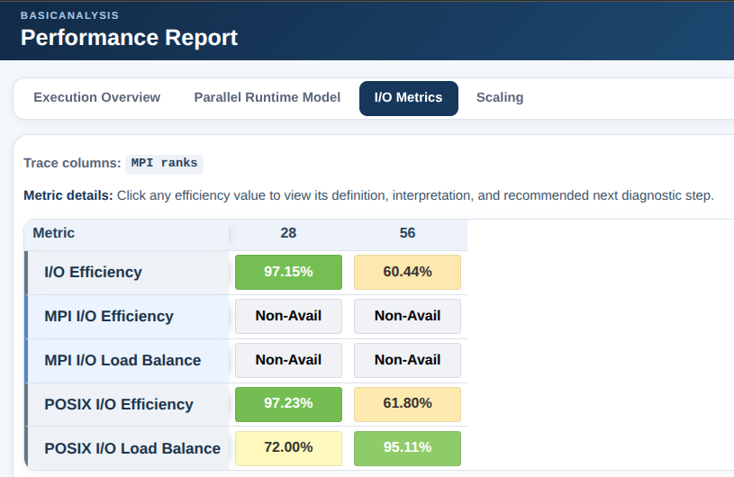

   I/O Analysis.

The **I/O Analysis** view is shown in
:numref:`fig-report-io-analysis`. Its efficiency table starts with **I/O
Critical-Path Efficiency**, the I/O cost on the critical path of the
execution, which is the product of:

* **I/O Efficiency**, the time spent in I/O, itself the product of **Data
  Access Efficiency** (read and write calls) and **File Management
  Efficiency** (open, close, seek, and control calls); and
* **I/O Load Balance**, the waiting caused by an uneven distribution of the
  I/O time across the units.

The lowest factor identifies the aspect of the I/O to investigate. The I/O
efficiencies use the same thresholds as the other efficiencies, unless
others are set for them in ``metrics/definitions.yaml`` (see :ref:`I/O
Efficiency <io-efficiency-thresholds>`); the efficiency scale of the view
shows the thresholds in use.

With several executions, the **I/O Efficiency Trends** plot follows the
efficiency table. Below them, the **I/O diagnostics** are shown in four
cards, in reading order. Each card starts with a short note on how to read
it and shows the diagnostics as plots, one bar per execution; hovering over
a bar shows its value, and the **Values** link under each plot opens the
table of the plotted values:

* **Where is the I/O time spent?** The share of the I/O time of each call
  (read and write, the Data Access calls, and open, close, seek, and
  control, the File Management calls) and, when an execution uses MPI-IO,
  of each API, as one stacked bar per execution. Then the average and
  maximum I/O time fractions, the participation, and the load balance of
  Data Access, read, write, File Management, and open.
* **Which calls take the time?** The time, number of operations, and mean
  duration (logarithmic scale) of each kind of call, and the share of
  redundant seeks (seeks to the position the descriptor already has).
* **What requests are made?** The volume and the mean request size
  (logarithmic scale) of the read and write calls; the request-size
  coverage is in the values. The *request-size histograms* below show, for
  the calls of every API (POSIX, ANSI C, and MPI-IO), the share of the
  requests (top panel) and of the time (bottom panel) in each power-of-two
  size interval. Compare the two panels: an interval with few requests and
  much of the time holds the expensive requests. Hovering over a bar shows
  the number of requests, the time, and the bytes. See
  :ref:`requests <io-request-sizes>`. Above the *access pattern* plots, a
  legend explains each class with the color of its bars. The plots show, for
  the reads and the writes of the POSIX and ANSI C calls to regular files,
  the share of the requests, of the bytes, and of the time that are
  consecutive, strided, forward, backward, first, or with an unknown
  offset, as one stacked bar per execution and quantity; the values add the
  volume in consecutive requests, the volume re-accessed, and the offset
  coverage. See :ref:`access pattern <io-access-pattern>`.
* **Which files are accessed?** A table with the files accessed, maximum
  processes per file, volume moved by the main process of each file, and
  file-name coverage. Then, for each execution, the I/O time of the ten
  files with the most I/O time (POSIX and ANSI C calls), split into read,
  write, and the other calls, with the share of the bytes moved by the main
  process of the file at the end of each bar. The last bar collects the
  calls on descriptors without an open in the trace. Hovering over a bar
  shows the full path, the processes, the bytes read and written, and the
  share of the bytes read and written in consecutive requests (the access
  pattern of the file; also in the values); all the files are in
  ``io_files.csv``. See :ref:`files <io-files>` and :ref:`access pattern
  <io-access-pattern>`.

The printable report shows the plots without the tables of values.
These values are not efficiencies, so they have no color scale; rows of
calls or APIs that no execution uses are omitted. The same diagnostics are
printed in the standard output and written to ``io_metrics.csv``; see
:ref:`I/O diagnostics <io-diagnostics>`.

The I/O metrics are reported independently from the hierarchical
performance-efficiency model and must not be interpreted as additional
multiplicative components of Global Efficiency, Parallel Efficiency, or
Computation Scalability. When no File I/O is detected, they are reported as
``Non-Avail``.

Use the I/O Analysis view when File I/O represents a relevant fraction of the
execution or when the distribution of I/O activity requires further
investigation. Detailed trace analysis or specialized I/O tools may be required
to determine the underlying cause of an observed I/O limitation.

Scaling
-------

The **Scaling** view analyzes how performance and efficiency factors evolve
across the analyzed execution configurations.

:numref:`fig-report-scaling-performance` shows the first part of the Scaling
view, which reports the detected and selected scaling model and compares the
measured Speedup and Efficiency with their ideal behavior.

.. _fig-report-scaling-performance:

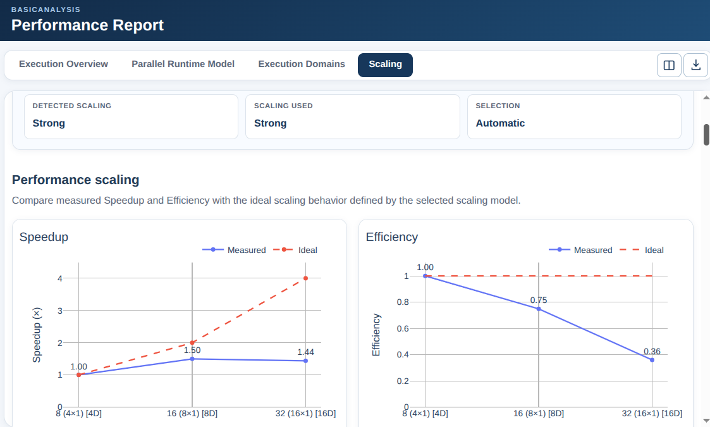

   Scaling model and performance trends.

The remaining plots show how the efficiency hierarchy and complementary
runtime/domain metrics evolve across configurations.
:numref:`fig-report-scaling-metrics` shows an example of one of these metric
trends.

.. _fig-report-scaling-metrics:

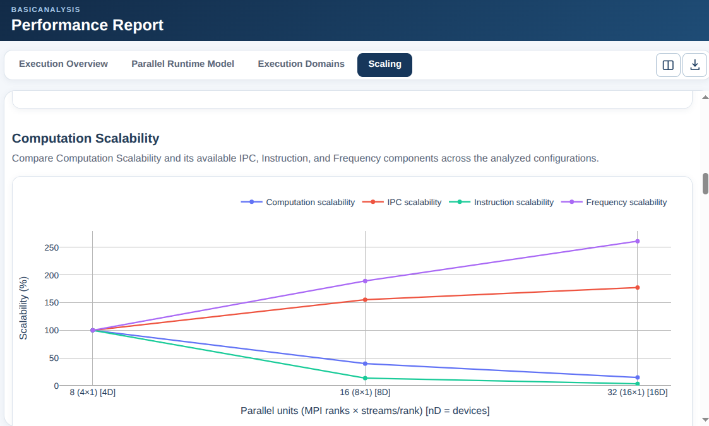

   Efficiency-factor scaling trends.

Depending on the programming model and the available performance data, these
can include:

* Global Efficiency, Parallel Efficiency, and Computation Scalability.
* Load Balance and Communication Efficiency.
* Computation Scalability and its available IPC, Instruction, and Frequency
  components.
* Runtime-specific Parallel Efficiency contributions.
* MPI Load Balance, Communication, Serialization, and Transfer Efficiency.
* Host execution-domain metrics.
* Device execution-domain metrics.
* I/O-related metrics when available.

For GPU traces, the *Device Computation Scalability* plot is followed by the
card **Which kernels change the device time?**. It lists the ten kernels with
the largest share in the change of the device time from the ideal of the
scaling model, for one execution compared with the reference (see
:ref:`device-kernel-contributions`). A selector chooses the execution (the
largest one by default), and the printable version shows every execution.
Hover over a kernel for its full name.

Computation Scalability and its associated factors are evaluated relative to a
reference execution. A value of 100% indicates behavior equivalent to the
reference under the selected scaling model, values below 100% indicate
degradation, and values above 100% indicate improvement.

Other efficiency metrics shown in the Scaling view retain their own metric
definitions. Their trends should be interpreted by examining how the metric
value changes across configurations rather than assuming that every plotted
metric is normalized to the reference execution.

Use the trends to identify which factors degrade as the application scales. A
degrading metric identifies where the scalability loss becomes visible, but it
does not by itself establish the root cause. Further trace analysis may be
required to explain the observed behavior.

Metric Details
--------------

The interactive report provides additional information for each performance
metric through the **Metric Details** view. This information helps users
understand the meaning of a metric value and identify the next steps for
further performance analysis.

To open the Metric Details view, click a metric value in any of the interactive
efficiency tables. A dialog is displayed for the selected metric and execution,
as shown :numref:`fig-report-metrics-details`.

.. _fig-report-metrics-details:

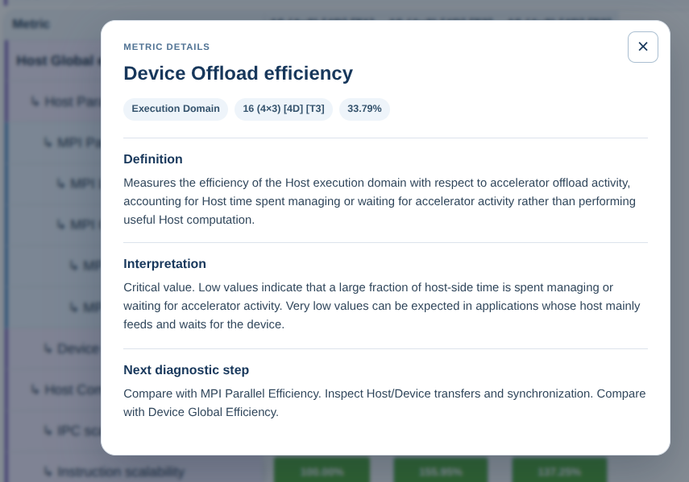

   Metric Details view for Device Offload Efficiency. The dialog provides the
   metric definition, interpretation of the selected value, and recommended
   next diagnostic steps.

The dialog identifies the metric, its analysis context, the selected execution,
and the corresponding metric value. It then provides:

* **Definition** -- explains what the metric measures from a performance-analysis
  perspective.

* **Interpretation** -- explains how to interpret the observed value. When
  applicable, the interpretation also accounts for the efficiency range
  associated with the value (for example, critical or low efficiency).

* **Next diagnostic step** -- recommends the subsequent analysis to investigate
  the performance factor represented by the metric, including related metrics
  or execution domains that should be examined.

The information presented in **Metric Details** is adapted to the selected
metric and its analysis context. This is particularly relevant for hybrid
applications, where the report distinguishes between application-level metrics,
contributions from the different parallel runtimes, and Host/Device
execution-domain metrics.

Comparing Complementary Views
-----------------------------

:numref:`fig-report-split-view` shows the split-view option, which allows two
analysis views to be displayed simultaneously.

.. _fig-report-split-view:

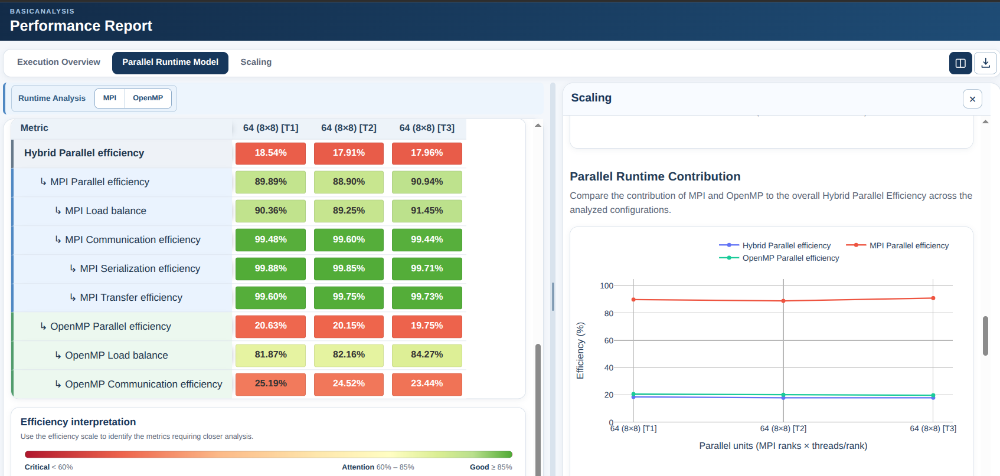

   Complementary split-view analysis.

This is useful when evidence from two analytical perspectives should be
compared directly, for example:

* Parallel Runtime Model with Scaling;
* Parallel Runtime Model with Host/Device Model (TALP);
* Parallel Runtime Model with I/O Analysis;
* Host/Device Model (TALP) with Scaling; or
* Execution Overview with a detailed analytical view.

The two views remain analytically independent. The split layout is intended to
facilitate comparison, not to imply that the metrics shown in both panels
belong to the same multiplicative model.

Exporting Report Content
------------------------

The export control provides several ways to save analysis results.

.. _fig-report-export-menu:

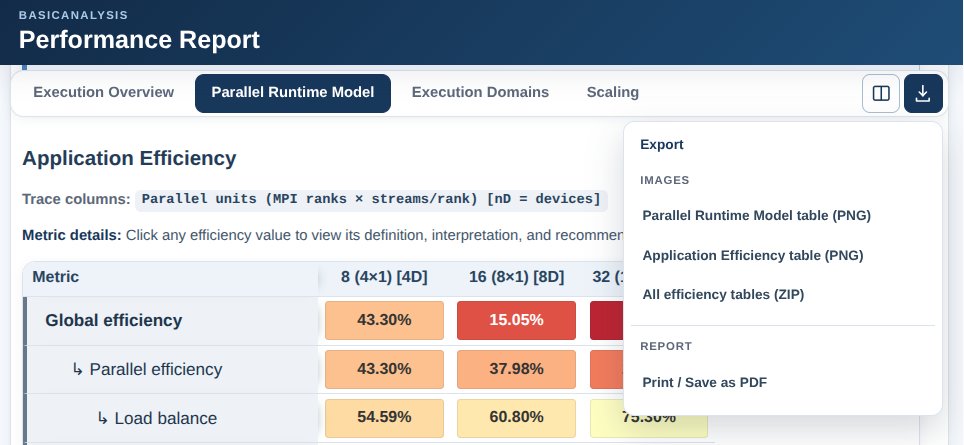

   Report export menu.

Depending on the active analysis, efficiency tables can be exported as PNG
images. Multiple tables can also be exported together, and all available
efficiency tables can be saved in a ZIP archive. In the GPU Hardware
Counters view, the exported table includes the indicators below SM
Utilization and its factors. The exported tables keep the trace
identifiers of the columns (``[T1]``, ``[T2]``, ...), so that they can be
referenced in papers and slides.

:numref:`fig-report-export-menu` shows the export menu for saving an efficiency
table from the Parallel Runtime Model view as a PNG image.

The complete report can be exported using **Print / Save as PDF**. This
generates the printable report from the current analysis data and opens the
browser print dialog, where the report can be saved as PDF.

PDF generation is therefore initiated explicitly from the interactive report;
BasicAnalysis does not automatically generate a PDF during normal execution.

.. _sec:report-programming-model-comparison:

Programming Model Comparison
----------------------------

When the analyzed traces use different programming models (see
:ref:`sec:comparing-programming-models`), the report is organized into tabs
instead of the views described above:

* **Programming Model Comparison**, which compares all the analyzed traces.
* One tab per programming model, for example **MPI**, **MPI+OpenMP**, or
  **MPI+CUDA**, with the complete report of the traces of that model.

.. _fig-report-programming-model-comparison:

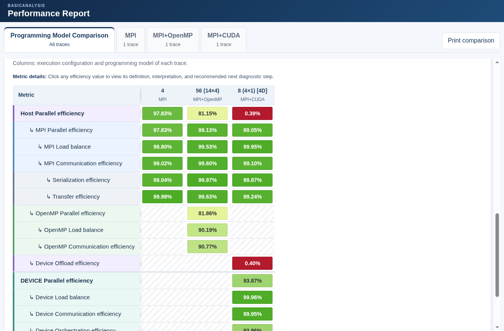

   Programming Model Comparison of MPI, MPI+OpenMP, and MPI+CUDA executions.

The **Programming Model Comparison** tab contains:

* the programming models compared and the reference execution used for
  Speedup;
* the trace configuration and execution mapping of all the traces;
* general metrics: elapsed time, Speedup, average IPC, and average frequency;
* the efficiency metrics of each trace, organized as described in
  :ref:`sec:methodology-programming-model-comparison`; and
* I/O metrics, when File I/O activity is detected.

In the efficiency table, shown in
:numref:`fig-report-programming-model-comparison`, each column shows the
metrics of the programming model of the corresponding trace. Hatched cells
correspond to metrics that do not apply to that programming model, such as the
OpenMP metrics of an MPI+CUDA execution. Device metrics are grouped after the
Host metrics.

Metric values can be clicked to open **Metric Details**. Each value opens the
description of the metric of its own programming model. For example, in the
MPI Load Balance row, the value of an MPI execution describes Load Balance,
while the value of an MPI+CUDA execution describes the MPI Load Balance of the
Host.

Each programming-model tab contains the complete report of the traces of that
model, analyzed as an independent set: Execution Overview, Parallel Runtime
Model, Host/Device Model (TALP), I/O Analysis, and, when the tab contains several
traces, Scaling. The report of each tab is the same report that BasicAnalysis
generates when those traces are analyzed alone, and it provides its own
navigation, Metric Details, and export functions.

The **Print comparison** button prints the Programming Model Comparison tab
or saves it as PDF. The report of each programming model is printed from its
own export menu.

A typical comparison starts in the Programming Model Comparison tab to
identify which implementation shows the largest efficiency losses and in which
factor, and continues in the tab of that programming model to analyze the
losses in detail.

Following the Analysis Workflow
-------------------------------

The report views are designed to be used together rather than as independent
analyses. A typical analysis follows this progression:

#. **Verify the executions** in the Execution Overview.
#. **Identify the dominant efficiency loss** using Global Efficiency and its
   hierarchy.
#. **Determine the responsible parallel runtime** using the Parallel Runtime
   Model.
#. **Explain the runtime contribution** using Runtime-Specific Analysis.
#. For accelerator applications, **identify where the inefficiency manifests**
   using the Host and Device execution domains.
#. When File I/O activity is relevant, **evaluate its weight and distribution**
   using I/O Analysis.
#. **Examine how the relevant factors evolve** across configurations in the
   Scaling view.
#. Use detailed trace analysis or specialized performance tools when additional
   evidence is required to determine the underlying cause.

This workflow is not strictly linear. The different views provide
complementary evidence and may use different analytical scopes.

The Execution Overview establishes the context of the experiment. The
hierarchical performance model identifies whether a significant performance
loss exists and which broad factor dominates. The Parallel Runtime Model and
Runtime-Specific Analysis attribute and explain parallel-runtime losses.
The Host/Device Model (TALP) localizes accelerator-related inefficiencies to
the Device or Host side. I/O Analysis independently characterizes the contribution and
distribution of File I/O activity. Finally, the Scaling view shows how these
relevant performance characteristics evolve as the execution configuration
changes.

Together, these views progressively narrow the analysis from identifying a
performance problem to determining which factors, runtimes, execution domains,
or complementary activities should be investigated in greater detail.